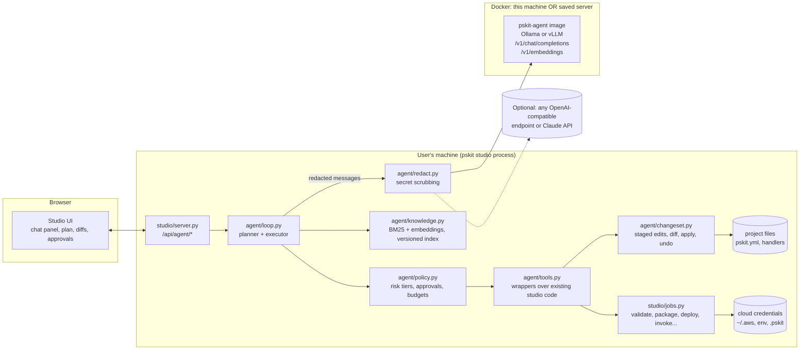
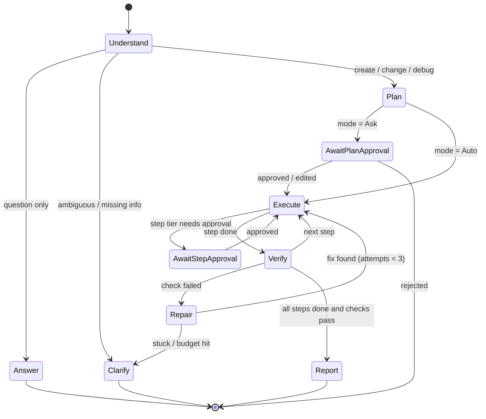

# 2. Architecture

## 2.1 Components and where they run



| Component | Runs in | Why there |
|---|---|---|
| Chat UI | Browser (existing single-file React build) | Same app, same token auth, same draft/validation store |
| Agent loop, tools, policy, retrieval, changesets | **Studio process** | Needs project files, the draft, jobs and the user's credentials. Those must never be copied into a container |
| Model server | **Docker container** (local or on a saved SSH server) | Heavy, needs GPU/RAM, may be on a stronger machine than the laptop |
| Knowledge index | Shipped in the wheel (`agent/knowledge/index-<version>.json.gz`), embeddings computed lazily | Matches the **installed** pskit version |

Constraints: `studio/agent/` uses only the stdlib (`urllib`, `json`, `sqlite3`, `threading`, `difflib`) and runs on
Python 3.9. No new install-time dependency for pskit.

## 2.2 Agent loop

One **session** = one chat thread bound to a project folder, provider and stage (taken from the studio top bar).
One **turn** = the user's message → the agent works until it answers, needs approval, or reaches a budget limit.



### Phases inside a turn

1. **Understand.** Classify the intent (`ask | create | change | debug | operate`) and gather context with read-only
   tools (all tier 0, never need approval): the project snapshot, current validation issues, retrieved docs, the
   last failed job's log if the user says "it failed".
2. **Plan.** For anything that changes state, the model emits a **structured plan** (JSON, schema-checked):
   ```json
   {"goal": "Add an SQS-triggered worker that writes to S3",
    "steps": [
      {"id": 1, "action": "add_resource", "summary": "queue `orders` (managed)", "tier": 1},
      {"id": 2, "action": "create_function", "summary": "`process_order` with queue trigger on `orders`", "tier": 1},
      {"id": 3, "action": "write_file", "summary": "handler src/orders.py", "tier": 1},
      {"id": 4, "action": "validate", "summary": "pskit validate (aws/dev)", "tier": 2},
      {"id": 5, "action": "invoke_local", "summary": "run with a sample queue event", "tier": 2}],
    "assumptions": ["provider aws, stage dev (top bar)"],
    "questions": []}
   ```
   The **tier comes from the policy (code), not from the model**. Whatever the model writes there is ignored.
3. **Execute.** Each step is one or more tool calls. File and config changes go into the session's **changeset**
   (see 03), not straight to disk.
4. **Verify.** After changes: run the same checks as `pskit validate` on the draft (in-process, fast). Code: `ruff`
   when available, `pskit invoke` locally with a sample event, the project's `pytest` if it has tests. Debug turns
   re-run whatever failed first.
5. **Repair.** If a check fails, the error goes back to the model with the related doc chunks. At most 3 attempts
   per failure signature, then it stops and explains what it tried.
6. **Report.** A short summary: what changed (diff), what was checked, what's left (e.g. "deploy not run: needs your
   approval").

### Budgets (enforced by the loop)

| Limit | Default | Why |
|---|---|---|
| Tool calls per turn | 40 | Stops runaway loops |
| Same failing check signature | 3 | Stops repeating the same fix |
| Wall time per turn | 15 min (deploys excluded from the count while running) | |
| Tokens of context | 80% of the model's window, then compaction | Long debug sessions |
| Model errors / bad tool JSON | 2 retries with the parse error shown to the model, then constrained-JSON fallback | Small models |

## 2.3 Context building (what the model sees each call)

Ordered and budgeted (tokens are for a 32k window; scaled with the model):

| Block | Budget | Source |
|---|---|---|
| System prompt: role, pskit rules (Python 3.9, handlers portable across clouds, `${tf:...}`, never invent options), tool protocol, citation format | ~2k | `agent/prompts/system.md`, versioned with pskit |
| Environment card: pskit version, provider, stage, OS, runtime, which tools are enabled, mode (Ask/Auto) | ~300 | studio state |
| Project snapshot: `pskit.yml` (redacted), file tree (depth 3, ignores applied), validation issues, last deploy record summary | ≤ 6k | `project.py`, `files.py`, `deployment.json` |
| UI focus: the page and item the user has open (e.g. *Functions → process_order*), selected text, open file | ≤ 1k | sent by the UI with each message |
| Retrieved knowledge: top-k chunks with source paths | ≤ 8k | `knowledge.py` |
| Conversation: recent turns verbatim, older turns as a running summary | rest | session store |
| Tool results: truncated (head + tail + error lines), large outputs available on request (`read_job_log(offset)`) | per call ≤ 4k | tools |

**Compaction:** when the context is over budget, older tool results are swapped for one-line summaries, then older
turns are summarised (by the same model) into a "session notes" block. The plan and the changeset are always kept
in full.

## 2.4 Knowledge (retrieval)

**Build (at release, in CI, `ai-agent/knowledge/build.py`):**

| Source | Chunking | Metadata |
|---|---|---|
| `docs/**/*.md` | by heading (H2/H3), 300–800 tokens, heading path kept as a prefix | `path#anchor`, title, provider tags |
| `examples/*/` | one chunk per example: `pskit.yml` + handler + README | example name, providers, trigger types |
| Pydantic schema | one chunk per model/field group with type, default, description, allowed values | field path (`functions.*.triggers[].queue`) |
| Provider capabilities | generated from each `Provider.describe()` | provider |
| Source code | public functions/classes with docstrings; error-raising lines with their message | module, symbol |
| `CHANGELOG.md` | per version | version |
| `docs/troubleshooting.md` + error strings found in tests | per error | error signature |

Output: `index-<version>.json.gz` (chunks + BM25 statistics), a few MB, shipped in the wheel. Embeddings are
**not** shipped (they depend on the embedding model). Studio computes them once through the model server's
`/v1/embeddings` and caches them in `~/.cache/pskit/agent/emb-<version>-<model>.sqlite`. Without embeddings, BM25 alone
is used.

**Query:** hybrid score = BM25 (identifier-aware tokenizer: splits `snake_case`, dotted paths, keeps `${...}`) +
cosine (if available), merged with reciprocal-rank fusion. Boosts for chunks tagged with the current provider.
Top 6–10 chunks. Every answer about options must cite `path#anchor`. The UI turns citations into links that open
the built-in Guides/Markdown viewer.

**User project knowledge:** the user's own files are reached through tools (`read_file`, `search_project`), not
indexed, because they change constantly.

## 2.5 Model client

`agent/model.py`: one class over the OpenAI-compatible API.

- `chat(messages, tools, tool_choice, response_format, stream=True)` using `urllib` with SSE parsing, timeouts,
  retries with backoff, cancellation (the UI's **Stop** button closes the stream).
- **Tool calling:** native `tools` when the server reports support. Otherwise a **JSON protocol fallback**: the model
  must answer with `{"tool": name, "args": {...}}` or `{"final": "..."}`, with `response_format` = JSON schema
  (Ollama `format`, vLLM `guided_json`, llama.cpp `json_schema`), so even small models produce well-formed calls.
- **Config generation** can use the `ServiceConfig` JSON schema the same way, so a generated `pskit.yml` fragment
  always parses. Validation still runs afterwards because the schema can't express provider-specific rules.
- `embed(texts)` → `/v1/embeddings`.
- `capabilities()` probes `/v1/models` and a tiny tool-call request once per server and caches the result.

Backends offered in the UI: **pskit-agent (local Docker)**, **pskit-agent (saved server)**, **Native Ollama**,
**Custom OpenAI-compatible URL + key**, **Claude API (key)**. Keys are kept like studio's session-only provider variables
(never sent back to the browser) or, if the user asks, in `~/.pskit/agent.json` with user-only file permissions.

## 2.6 Sessions and persistence

- `.pskit/studio/agent/sessions/<id>.jsonl`: messages, tool calls, results (redacted), approvals, plan, changeset
  ids. `.pskit/` is already kept out of version control.
- `.pskit/studio/agent/checkpoints/<session>/<n>/`: file snapshots before each applied changeset (for undo).
- Sessions are listed in the chat panel and can be resumed, renamed or deleted, and exported (redacted) for a bug report
  or, with explicit consent, as training feedback (see 04 §4.8).

## 2.7 Concurrency with the user

The user may edit in the forms while the agent works. Rules:

- The agent edits the **same in-memory draft** as the forms (through the store API on the server side), so both see
  each other's changes; each agent edit is one undo step labelled "Agent: …".
- Before applying a changeset to disk, the changeset's base hash is compared with the file on disk (the same check
  Save already does when `pskit.yml` changed on disk). On conflict the agent re-reads the file and re-plans that step.
- Exclusive jobs (deploy, package, plan, remove) already go one at a time in `jobs.py`. The agent waits in the same
  queue and shows "waiting for the running deploy".
