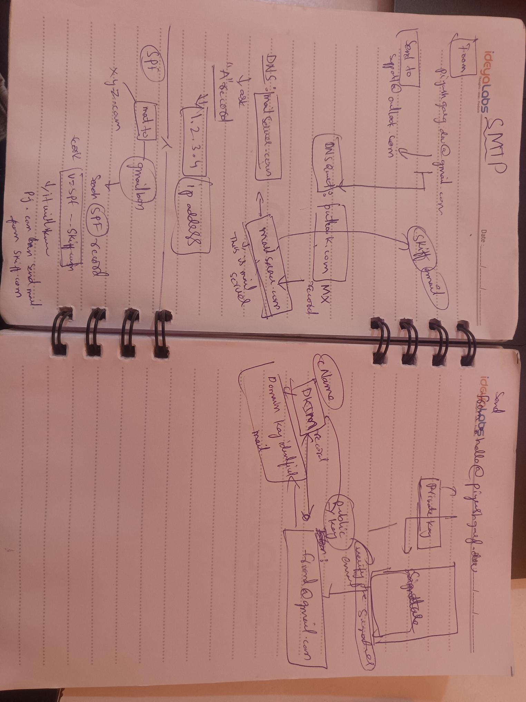

# E-mail triggers (SMTP) on premises

Run a function every time an e-mail arrives for your domain. The function gets the whole mail: sender, recipients,
subject, text and HTML body, headers and attachments. The data comes in two shapes: simple fields, and the event
Amazon SES gives Lambda, so code written for SES can read it unchanged.

It takes three steps:

1. **Create the SMTP server**: *Resources → + SMTP server* in the studio (or *On-prem services → + Create
   service → Mail*), on the functions' server or any SSH server.
2. **Attach functions**: tick them when creating it, or add `- smtp: {resource: <key>}` to a function.
3. **Add two DNS records** (A and MX) at your domain provider. The SMTP server's **DNS guide** button lists them with
   the right values.



## How it works

```
sender's mail server ──SMTP:25──> SMTP server (Docker: Node.js smtp-server + mailparser)
                                     │ refuses mail for other domains (never a relay)
                                     │ parses the mail
                                     └─HTTP POST /__pskit/smtp/<key>──> pskit host ──> every function with
                                                                                       `smtp: {resource: <key>}`
```

- The SMTP server is a `node:22-alpine` container that runs a small script (`core/onprem_smtp.js`) using nodemailer's
  [`smtp-server`](https://nodemailer.com/extras/smtp-server/) and [`mailparser`](https://nodemailer.com/extras/mailparser/).
  It installs both packages on first start and keeps them in its volume.
- It accepts mail only for the domains you list (and their subdomains). Senders do not log in, as usual between mail
  servers. Nobody can send mail *through* it.
- Each mail is posted to the pskit host with its `admin_token` (when the host has one). The host runs every attached
  function. If one fails, or none is attached yet, the sender gets a temporary error (`451`) and tries again later.
  No mail is lost, but a function may see the same mail twice.
- On an SSH server the container uses the host network: it listens on the port itself and reaches a pskit host bound to
  `127.0.0.1`. On this machine (Docker Desktop) it publishes the port and reaches the host as `host.docker.internal`.
  When the functions run on another server, the SMTP server posts to `http://<that server>:8080`. Set *pskit host URL*
  (`functions_url`) to override this.

## Create it

In the studio: **Resources → + SMTP server**.

| Field | |
|---|---|
| Resource key | e.g. `inbound-mail`; the trigger refers to it |
| Domains | e.g. `inbound.example.com`. Mail to any address there (and at its subdomains) runs the functions |
| Where | an SSH server (usually the functions' server) or this machine |
| Port | `25` (other mail servers always connect to 25) |
| Trigger functions | the functions to run for every mail |
| Advanced | *pskit host URL* and *Largest mail (MB)*, default 25 |

Already receive mail on your root domain (Microsoft 365, Google Workspace)? Use a **subdomain** such as
`inbound.example.com`. Changing the root domain's MX would stop every mailbox of the company from receiving mail.

From the command line it is the same service:

```bash
pskit resources onprem create inbound-mail --service smtp --domains inbound.example.com --attach on-mail \
  --ssh ubuntu@203.0.113.10
```

It adds this to `pskit.yml`:

```yaml
resources:
  inbound-mail:
    type: smtp
    external: true
    connection: {host: 203.0.113.10, port: 25, domains: inbound.example.com, hostname: mail.inbound.example.com}
functions:
  on-mail:
    handler: handler.on_mail
    events:
      - smtp: {resource: inbound-mail}     # or the shorthand `- smtp: inbound-mail`
```

Deploy (`pskit deploy`) so the host knows the trigger.

## DNS records at your domain provider

After creating it, open **DNS guide** on the service (also under *How to use*). It lists the records with your values:

| Type | Name (host) | Value | Why |
|---|---|---|---|
| A | `mail.inbound.example.com` | the server's **public** IP | the mail server's address |
| MX | `inbound.example.com` | `10 mail.inbound.example.com` | mail for `*@inbound.example.com` goes there |

- Most providers want only the part before your root domain in *Name*: `mail.inbound` and `inbound` for
  `example.com`, or `@` for the root domain itself. `10` is the MX priority; some providers have a separate field for it.
- **Cloudflare**: set the A record to *DNS only* (grey cloud). The proxy does not carry mail.
- Optional, for a subdomain that only receives mail: `TXT inbound "v=spf1 -all"`. This says the subdomain never sends
  mail, so nobody can send spoofed mail from it.
- Check the records with `nslookup -type=mx inbound.example.com` and `nslookup mail.inbound.example.com`. Changes show
  up after a few minutes, sometimes hours.

## Port 25

Allow inbound TCP 25 from anywhere in the server's firewall (Azure: network security group; AWS: security group; GCP:
VPC firewall rule; Linux: `sudo ufw allow 25/tcp`). Cloud providers often block *outbound* 25. That does not matter
here, because this server only receives.

Something else (Postfix) already uses 25? Create the SMTP server on another port and forward 25 to it:
`sudo iptables -t nat -A PREROUTING -p tcp --dport 25 -j REDIRECT --to-port 2525`.

## What the handler receives

`event.type` is `smtp` and `event.data` is the mail:

```python
import base64
import email


def on_mail(event, context):
    mail = event.data
    print(mail["from"], mail["to"], mail["cc"], mail["subject"])
    body = mail["text"] or mail["html"]
    for att in mail["attachments"]:
        data = base64.b64decode(att["content"])          # bytes
        print(att["filename"], att["content_type"], att["size"])

    # Code written for Amazon SES works on the same event:
    ses = mail["Records"][0]["ses"]
    print(ses["mail"]["commonHeaders"]["subject"], ses["receipt"]["recipients"])
    message = email.message_from_bytes(base64.b64decode(mail["content"]))   # the raw MIME message
    return {"ok": True}
```

```javascript
exports.onMail = async (event) => {
  const mail = event.data;
  console.log(mail.from, mail.to, mail.subject, mail.text);
  for (const att of mail.attachments) {
    const data = Buffer.from(att.content, "base64");
  }
  return { ok: true };
};
```

| Field | |
|---|---|
| `from`, `from_name` | the sender's address and display name (From header) |
| `to`, `cc`, `reply_to` | address lists from the headers |
| `bcc` | recipients of this delivery that are not in To / Cc |
| `subject`, `date` (ISO 8601), `message_id`, `in_reply_to`, `references` | |
| `text`, `html` | the body (`""` when the mail has no such part) |
| `headers` | `{lower-case name: value}` (the first of each name) |
| `attachments` | `[{filename, content_type, disposition, size, content_id, checksum, content}]`; `content` is base64 |
| `envelope` | `{mail_from, rcpt_to}`: the SMTP envelope (the real recipients on this server) |
| `remote_ip`, `helo`, `tls`, `size`, `received_at`, `server`, `id` | about the delivery |
| `Records` | the Amazon SES receipt event: `Records[0].eventSource` is `aws:ses`, `.ses.mail` (`source`, `destination`, `headers`, `commonHeaders`, `messageId`, `timestamp`) and `.ses.receipt` (`recipients`, verdicts, `action`) |
| `content`, `content_encoding` | the raw message in base64, as an SES → SNS action with `encoding: BASE64` delivers it |

pskit does not scan for spam or viruses, and it does not check SPF, DKIM or DMARC. Those SES verdicts are `GRAY`.

## Test it

- **Without DNS**: *Test* in the studio, or `pskit trigger on-mail`. A test mail goes to the deployed host as if the
  SMTP server had received it. Locally, `pskit invoke -f on-mail -t smtp -d '{"from": "a@b.org", "to":
  ["x@inbound.example.com"], "subject": "Hi", "text": "Hello"}'` turns that into the full event.
- **Through the SMTP server**: from any machine that reaches the port:

  ```python
  import smtplib
  from email.message import EmailMessage

  msg = EmailMessage()
  msg["From"], msg["To"], msg["Subject"] = "me@example.org", "test@inbound.example.com", "Hello"
  msg.set_content("It works.")
  with smtplib.SMTP("203.0.113.10", 25, timeout=30) as s:
      s.send_message(msg)
  ```

- **For real**: once the DNS records are visible, send a mail from any mail account to `anything@inbound.example.com`.

`pskit resources onprem logs inbound-mail` shows every mail the SMTP server received and what the host answered. The
host's logs (*Logs* in the studio) show which function ran with it.

## Change it

- Other domains, port or pskit host URL: remove the service and create it again with the same key.
- Another function: add `- smtp: {resource: inbound-mail}` to it and deploy. The SMTP server does not change.
- The host's `admin_token` changed: create the service again so it sends the new token.

## Troubleshooting

| Symptom | Cause and fix |
|---|---|
| Senders get `550 relay not permitted` | The address is not at one of the domains: recreate the service with the domain |
| Senders get `451 temporary failure` | No function has the trigger yet (deploy), a function failed (see the host logs), or the host is unreachable (check *pskit host URL* and `admin_token`) |
| Nothing arrives | `nslookup -type=mx <domain>` must show the A record's name, which must resolve to the public IP. Port 25 must be open: `Test-NetConnection <ip> -Port 25` / `nc -vz <ip> 25` |
| `552 message exceeds fixed maximum message size` | Raise *Largest mail (MB)* (up to 100) |
| The container restarts | `pskit resources onprem logs <key>`: the first start needs npm registry access to install `smtp-server` and `mailparser` |
